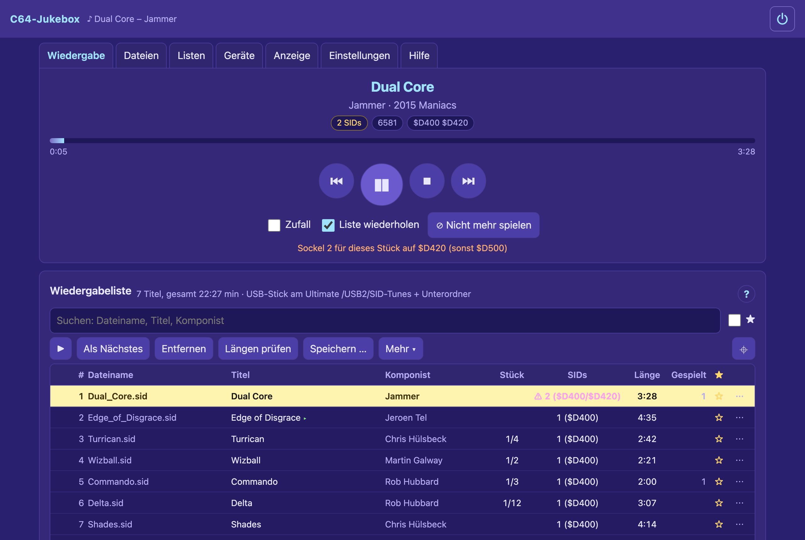
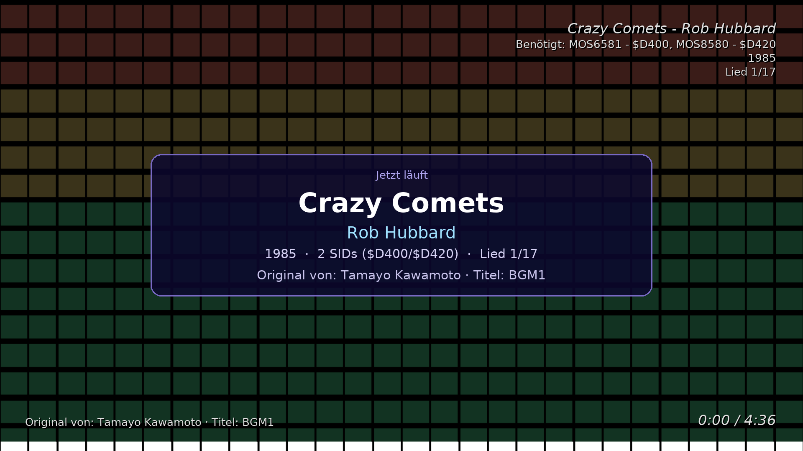
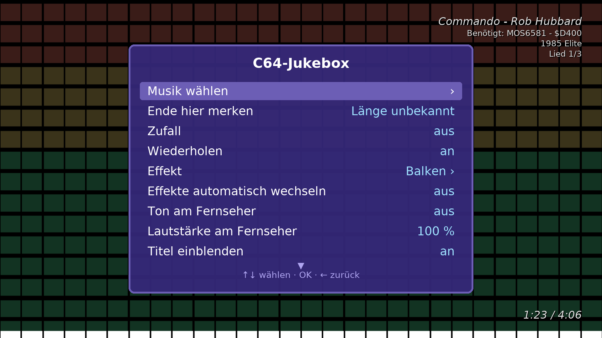
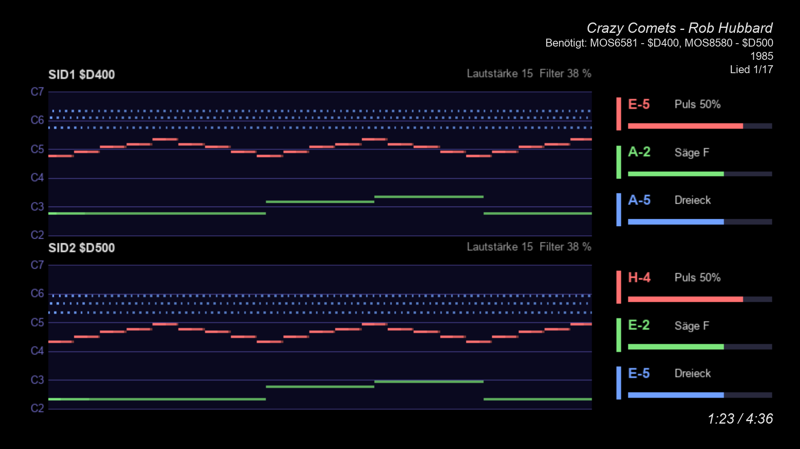
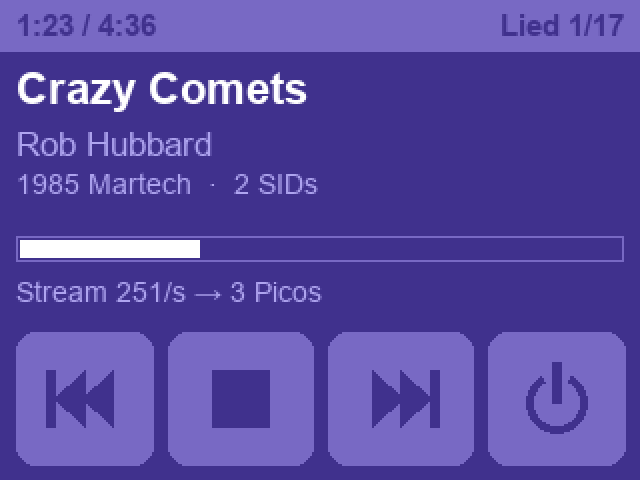

# C64 Jukebox – Raspberry Pi 3B as SID jukebox and stream distributor

*Deutsche Version: [README_DE.md](README_DE.md)*

**Manual (German):** [docs/HANDBUCH.md](docs/HANDBUCH.md) – the same manual is the **Hilfe** tab of the web page.
**Operating guide with pictures** (web page and TV): [docs/Operation_Pi-Jukebox.pdf](docs/Operation_Pi-Jukebox.pdf) – German version:
[docs/Bedienung_Pi-Jukebox.pdf](docs/Bedienung_Pi-Jukebox.pdf)

A Raspberry Pi 3B plays SID music on the **Ultimates** (Ultimate 64, C64 Ultimate, Ultimate II+) around the clock and is
controlled entirely through a **web page** (German) – on the phone as well as on the PC, at **http://c64pi.local/**.

- **SID files from anywhere:** network share (SMB: NAS, Windows, Mac, Linux – nothing is mounted), FTP server, the
  Ultimate's USB stick (its FTP service), or a folder / USB stick on the Pi
- **Easy picking:** sources as tiles, folders browsed like a file manager, filter, search through all sub-folders;
  every file shows title, composer, year, sub-songs, length and "2 SIDs"; **network search** finds servers,
  **"show shares"** lists the shares of a server
- **Play with one tap**, "play folder" including sub-folders, shuffle, repeat, sub-songs, pause/resume/stop
- **Song lengths** from the HVSC file `Songlengths.md5` (MD5 over the whole file, per sub-song) to change tunes exactly
  at the end, own lengths take precedence; otherwise a time limit or "next after N s of silence"; "remember end here"
  (web page and TV menu) makes the time a tune without a length has played so far its own length; **repeat
  detection:** for tunes without a length the jukebox finds in the stream where the tune starts again and suggests it;
  **length by name:** another version of the file (other MD5) is found in the HVSC by file name/title and composer;
  **`tools/find_lengths.py`** finds the lengths of whole folders on the Mac in advance (name, playing with libsidplayfp:
  end/repeat) as a `user_songlengths.txt`
- **TV remote control (HDMI-CEC, optional):** play/pause/stop/next, style and sub-tune with the TV's remote; if
  wanted the TV switches on when playing starts and off when nothing plays - no extra program needed
- **Party mode:** away from home the Pi opens a WLAN under the home WLAN's name (Picos and phones join by themselves),
  the Ultimate is on the Pi's cable; at home the mode stays quiet
- **Lists put together:** from the whole HVSC (paths and lengths from the song-length file): favourites, most
  played, never played, random, short, multi-SID tunes, own choice by area, composer, length, STIL
- **Timer:** on chosen weekdays at a chosen time play a list or stop, the TV with it if wanted (HDMI-CEC)
- **Recently played:** the last 100 tunes with their time, play again or take them over as a new list
- **Search the whole HVSC:** instantly from `Songlengths.md5` (paths) plus titles and composers read once – on the
  page (🔍 HVSC) and on the TV with the on-screen keyboard
- **As an app on the phone:** "Add to Home Screen" (iPhone/Android) gives the page its own icon and full screen
- **Bluetooth headphones:** search, pair, connect on the page; the TV sound goes to them while they are connected
- **German or English:** the page, the TV menu, the displays and the manual – chosen under Settings → System
- **Updates on request:** a newer version on GitHub is shown on the page and in the TV menu; "Installieren" there downloads it and runs the installer (the old program comes back if that fails)
- **Switching off:** "Jukebox ausschalten" (⏻ at the top of the page, the TV menu or the touch display) shuts the Pi down cleanly; on a Tuya smart plug (e.g. Antela, app "Smart Life") it sets the plug's timer first, so the power goes once the Pi is down - back on by app or voice assistant
- **Never play again:** a blocked list per file (MD5) – moving on, shuffle, discover and generated lists skip blocked
  tunes; chosen by hand they still play
- **HVSC STIL:** background of the running tune ("covered from", sub-tune names, remarks) on the page and on the TV;
  tunes outside the HVSC are found by their MD5
- **Play list as a table window like the PC program** (Ultimate64 SID Player): file name, title, composer, sub-song,
  SIDs, length (HVSC / own* / estimated), plays, ★; sort by column, search the whole list, multi-select, "play next",
  remove, drag to reorder, row menu, keyboard shortcuts; the running tune is marked and always in view; smooth even with
  a whole HVSC (only the visible rows exist)
- **Play lists:** save, load, append; the current list survives a restart
- **Import the PC program's play lists** (shared playlist `.json` with the same rules: MD5 before file name; `.u64pl`
  matched by the longest path end) and export shared playlists; take over `play_counts.json`, `favorites.json`,
  `user_songlengths.txt`
- **Play counts, favorites, own lengths** per MD5 like the PC program; shuffle prefers less played tunes; **discover**,
  **stop after** N tunes or minutes, remove duplicates, statistics
- **Own WLAN** when there is neither cable nor a known WLAN – avoids the Picos' access points (192.168.4.1); scan and
  join WLANs on the page
- **Display:** small OLED (0.96" SSD1306 or 1.3" SH1106, I2C, 4 wires) or a **2.8" colour display with touch**
  (ILI9341 + XPT2046, SPI, jumper wires): running tune, network, credentials of the own WLAN; on the touch display
  buttons ⏮ ■ ⏭, L/R level meters, page change by a tap, touch set-up with three crosses
- **TV (HDMI, 1920 × 1080):** the PC jukebox's 17 visualizer styles (Spectrum Analyzer) to the music, the real SID voices as a piano roll (from the Ultimate's debug stream), over a slide
  show of own pictures (cross-fades, uploaded through the page) or over the **live picture of the C64** (the Ultimate's
  video stream, 4:3); title, SID chips and time shown, automatic style change, sound over HDMI if wanted, with fade-out/in between songs; the effects fade out without music; **retro news**
  (Indie Retro News, amiga-news.de, Commodore News, Cascade64, The Oasis BBS and more, own RSS feeds) as a card while
  idle or as a ticker (the headlines also scroll on the Picos' matrices while idle); own service, the graphics chip scales
  and blends
- **"Breadbin" case with a mini monitor** in the style of the Commodore 1702 for Pi + 2.8" display to 3D-print (`case/`)
- **SID addresses**: if a tune needs a second SID at another address, the jukebox switches a free socket of the
  Ultimate and back afterwards (like "Auto-adjust SID addresses" of the PC jukebox; never UltiSIDs); tunes whose
  addresses the Ultimate lacks are marked purple with ⚠ in the list
- **Several Ultimates** with a choice which one plays; network search (one entry per device, Ethernet address)
- **Titles on the Pico visualizers** (`POST /jb/np` with digest login, or without password as UDP `C64NP1`, clock
  update every 30 s, `stop=1` at the end)
- **Stream distributor:** the Pi takes the audio stream by unicast over Ethernet and passes every packet on unchanged
  to all Picos in its list – no multicast
- **Devices in the network:** announces itself like the Picos (UDP 11064, `t:"pi"`) and shows the Picos and the
  stream's way
- **Password** (first password `commodore64`, as on the Picos), **backup** of all settings as one file
- Installed by **one script** on Raspberry Pi OS Lite (64 bit, Trixie or Bookworm) as a systemd service

## Pictures

<p></p>
<p>


</p>
<p>


</p>

*The web page on the PC (in German); on the TV a style with the “now playing” card, the menu for the TV remote and
the SID voices as a note roll; the optional touch display on the Pi. Operating guide with pictures:
[docs/Operation_Pi-Jukebox.pdf](docs/Operation_Pi-Jukebox.pdf).*

> **Guide for all three devices together** (visualizer, audio receiver, Raspberry Pi jukebox – setup, chaining,
> operation, illustrated): [docs/Guide_C64-Ecosystem.pdf](docs/Guide_C64-Ecosystem.pdf) – German version:
> [docs/Anleitung_C64-Oekosystem.pdf](docs/Anleitung_C64-Oekosystem.pdf)

## What was tested – and what not

**Tested on the real device** (Raspberry Pi 3B with Raspberry Pi OS "Trixie", Ultimate 64 Elite II and C64 Ultimate,
19–24 Oct 2026):

- Installation via `install/deploy.sh` (runs `install.sh`); service runs (~45–70 MB, ~10 % of one core), page answers
  in 9–28 ms
- Network search: Elite II and C64 Ultimate once each with their Ethernet address, plus the SMB hosts (4.2 s)
- Playing from the USB stick of the Elite II (direct) and of the C64 Ultimate (upload), sub-song, pause/resume, change
  at the end of a tune, missing file skipped, stop; HVSC song lengths (56,665 entries) and STIL from the stick
- Network share of a NAS (SMB 3): playing SIDs from it (upload), folder of 96 SIDs in 0.19 s; pictures for the slide
  show on the TV from the NAS
- Switching the Ultimate's SID sockets automatically and back
- Stream distributor: Elite II → Pi → audio receiver and two visualizers, ~251 packets/s each, stable; titles over UDP
  to the Picos
- TV (4K TV at 1080p): styles at ~30 frames/s, sound and picture of the C64, sound over HDMI with fade-out/in, slide
  show, the SID voices as a note roll, "now playing" card, control with the TV's remote (HDMI-CEC),
  volume control for the TV sound
- 2.8" touch display: picture, touch, calibration, buttons
- Repeat detection for tunes without a length runs on the Pi; "recently played" history in the "Listen" tab

**Not tested on the device yet:** shares over SMB 2 (older NAS) and from a Windows PC or Mac, a USB stick on the Pi itself (automatic
mounting), the small OLED display, the Pi's own WLAN and party mode.

**Automatic tests on the PC:** `pytest` with stand-ins for the Ultimate REST API, an FTP server (behaves like the
Ultimate's: no MLSD, Unix LIST), an SMB server (SMB 2/3 and the SMB 1 fallback), the share listing over DCE/RPC, Picos
(`/jb/np` with digest, UDP), the display controller (ILI9341 + touch) and the player with a simulated clock; plus
browser tests (Playwright) at phone and desktop size without JavaScript errors and without horizontal scrolling.

## Installation

Write Raspberry Pi OS Lite (64-bit) with the Raspberry Pi Imager (host name `c64pi`, SSH on). Then over SSH on the Pi:

```
sudo apt install -y git
git clone https://github.com/sedorrr/c64-pi-jukebox
cd c64-pi-jukebox
sudo ./install/install.sh
```

Or from a Mac/Linux PC in the project folder: `./install/deploy.sh <user>@c64pi.local`. Then open
**http://c64pi.local/**, password `commodore64`. Updating: `git pull` and `sudo ./install/install.sh` again; settings
stay.

## Tests on the PC

```
python3 -m venv .venv && .venv/bin/pip install -r requirements-dev.txt
.venv/bin/python -m playwright install chromium
.venv/bin/python -m pytest
```

To look at it without Pi and Ultimate: `.venv/bin/python tests/web/demo_server.py 8099` runs the jukebox with
stand-ins (Ultimate, FTP, SMB server `nas.local` with user `nutzer`/`geheim`, sample SIDs) at http://127.0.0.1:8099/.

## Project layout

See [README_DE.md](README_DE.md#projektstruktur) – `c64jukebox/` is the program (Python 3.11+, aiohttp, smbprotocol, pysmb),
`c64jukebox/web/` the page without build step, `install/` the installer, systemd unit and udev rule, `tests/` the
PC and browser tests.

## Notes on use

- **Home network only.** The web page uses plain HTTP without encryption. The stream distributor, titles (`C64NP1`)
  and retro news (`C64NEWS1`) to the Picos (UDP port 11001) as well as device messages (UDP 11064) work **without any
  login** – every device in the same network can send them. Do not make the Pi reachable from the internet (no port
  forwarding in the router). Change the start password `commodore64` (web page and own WLAN) right after setting it
  up. The jukebox stores the credentials of SMB/FTP sources and of the Ultimates on the Pi.
- **At your own risk.** Work on the C64, the Ultimate and the Pi (connecting displays, cases, switching Ultimates on
  and off over the network) is at your own risk. No liability is accepted for damage to devices, hardware or data
  (see also sections 15 and 16 of the GPL-3.0).
- **Retro news:** every 30 minutes the jukebox fetches the RSS feeds of public retro news pages (Indie Retro News, amiga-news.de, Commodore News, Cascade64, The Oasis BBS, and own
  ones if wanted) from the internet. Only headline, date, a short teaser and a small picture are shown, with the
  source; the content belongs to the respective pages. Every feed can be switched off on its own, as can sending
  them to the Picos.
- Only tested with the author's hardware and network – see [What was tested](#what-was-tested--and-what-not).

## License

Copyright (C) 2026 Sedor (der-sedor.de)

This program is free software: you can redistribute it and/or modify it under the terms of the **GNU General Public
License version 3** as published by the Free Software Foundation. It is distributed in the hope that it will be
useful, but **without any warranty**; without even the implied warranty of merchantability or fitness for a
particular purpose. The full text is in [`LICENSE`](LICENSE).

Third-party components (Python packages installed with pip and apt) and their licenses: [`THIRD_PARTY_NOTICES.md`](THIRD_PARTY_NOTICES.md).
