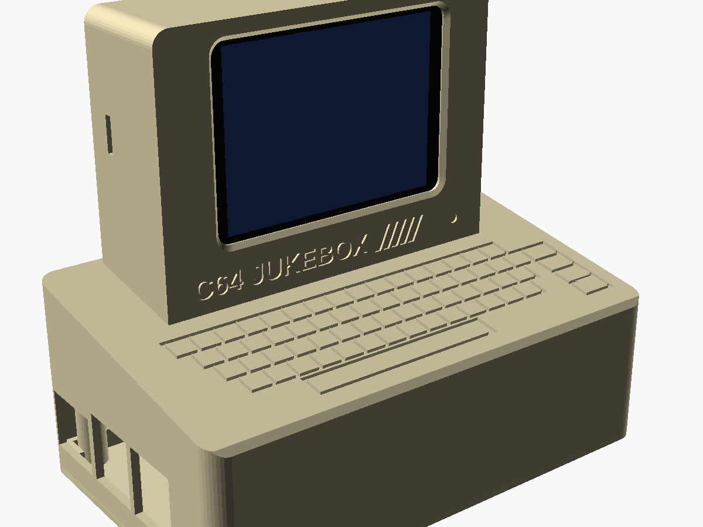
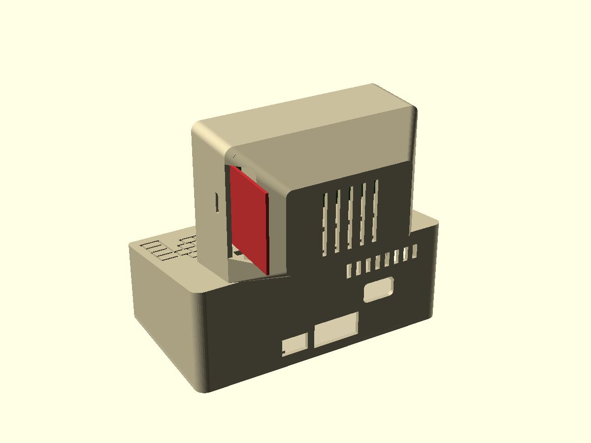
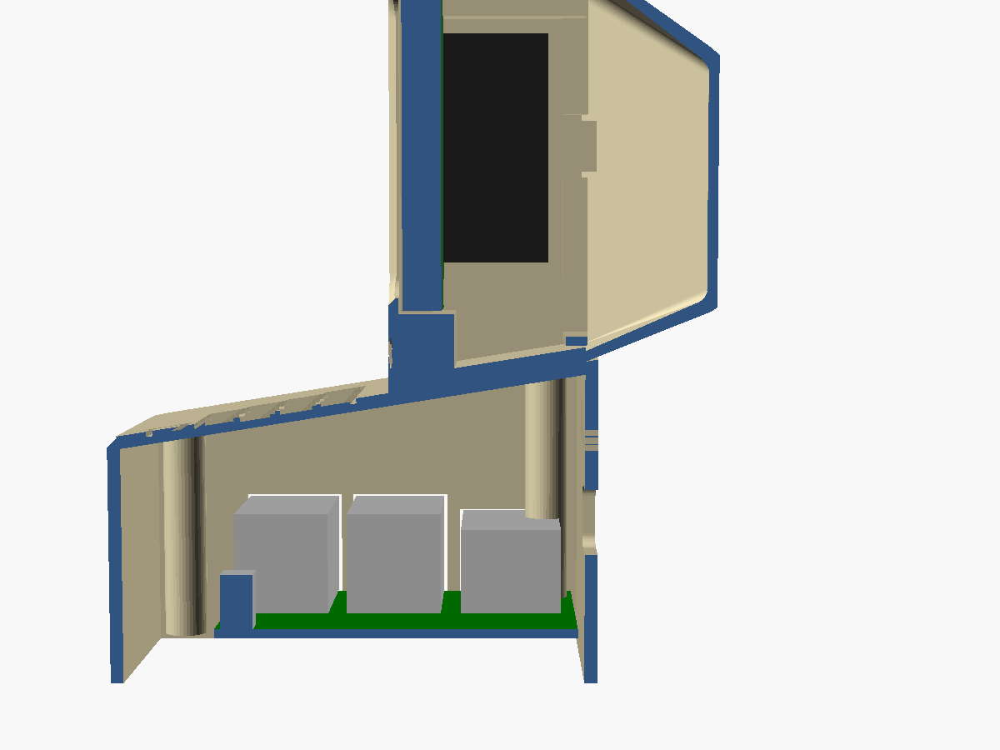
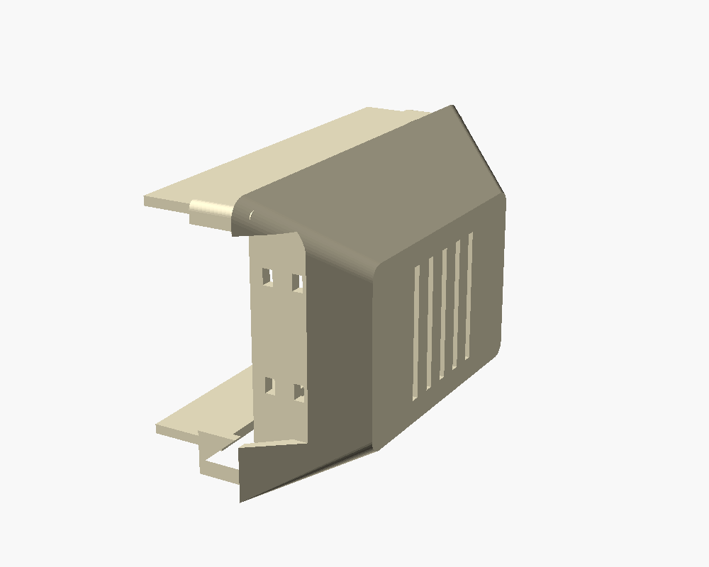
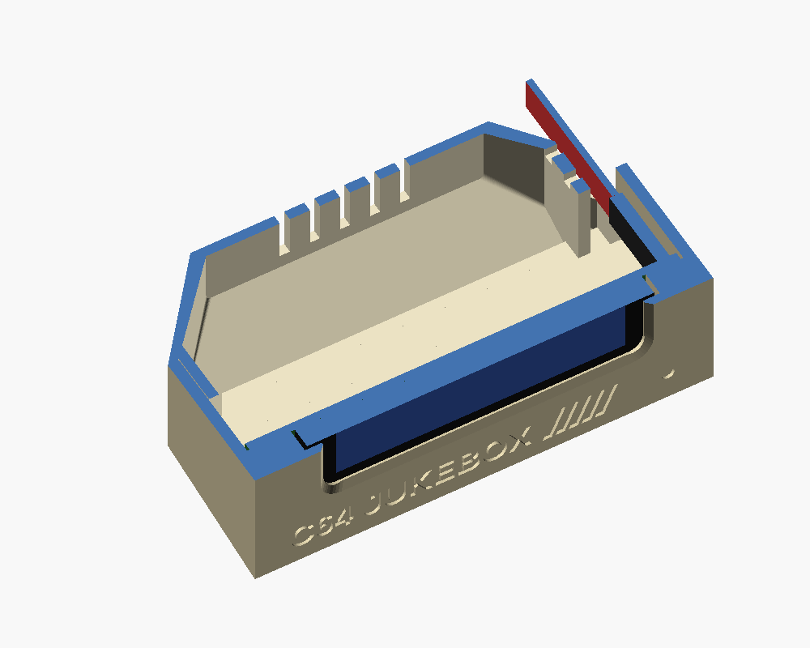
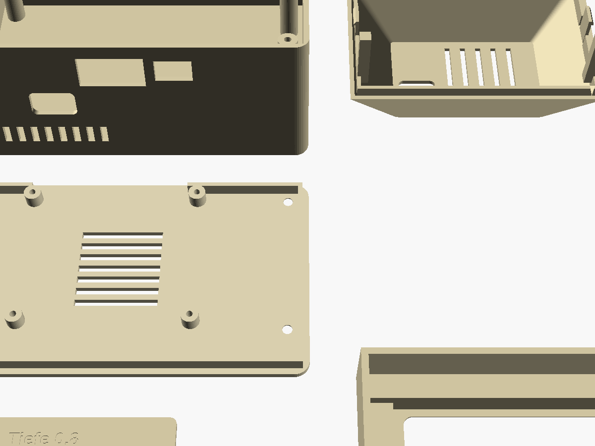

# Gehäuse „Brotkasten“ mit Mini-Monitor / "Breadbin" case with a mini monitor – Raspberry Pi 3B + 2,8″-Touch-Display

`pi_case.scad` (OpenSCAD) · STL in Druckrichtung / as printed: `pi_base.stl` (Boden / base), `pi_hood.stl` (Haube / hood),
`monitor_front.stl`, `monitor_back.stl`, `pi_test_piece.stl` (Probestück / test piece) ·
STEP für Fusion / FreeCAD (Einbaulage / assembly position): `pi_base.step`, `pi_hood.step`, `monitor_front.step`,
`monitor_back.step`, `pi_case.step` (alle / all) – aus / from `pi_case_to_step.py`








## Deutsch

**Außenmaße:** Brotkasten 124 × 75 mm, vorne 38 mm, hinten 50 mm hoch, oben eine eingravierte Tastatur mit Leertaste und
Funktionstasten. Darauf steht hinten ein kleiner Monitor im Stil des Commodore 1702 (91 × 65 mm, 30 mm tief plus
Bildröhren-Rücken, der 18 mm über die Rückseite hinausragt); gesamt rund 110 mm hoch. Im Monitor sitzt das
**2,8″-Display mit Touch** (ILI9341 + XPT2046, rote Platine 86 × 50 mm, z. B. ARCELI oder AZDelivery). Unter dem Bild
„C64 JUKEBOX“, Regenbogenstreifen und eine „Power-LED“. **Die Kabel gehen hinten aus dem Monitor heraus und hinten in
den Brotkasten hinein** (Loch im Bildröhren-Rücken links, Loch in der Rückwand direkt darunter). So kann der Monitor
auch **getrennt** stehen, etwa neben dem Fernseher: Auf dem Tisch lehnt er sich um die Schräge der Haube (rund 9°) nach
hinten – eine angenehme Neigung für einen Bildschirm – und steht dabei sicher. Für getrennte Aufstellung längere
Dupont-Kabel nehmen (30 cm oder mehr). Wer den Monitor fest auf dem Brotkasten will und keine Kabel außen sehen möchte:
oben in `pi_case.scad` `wires_out = "collar"` setzen und neu exportieren (Kabel durch einen Kragen unter dem Monitor).

**Anschlüsse:** links USB × 2 und Netzwerkkabel, hinten Strom (Micro-USB), HDMI und das Kabelloch für den Monitor,
hinten Lüftungsschlitze. (USB und Netzwerk sitzen beim Pi an einer anderen Kante als Strom und HDMI – alles nach hinten
geht deshalb nicht.)

| Datei | Teil | Drucken |
|---|---|---|
| `pi_base.stl` | Boden: 4 Sockel für den Pi (M2,5 × 6 mm, selbstschneidend), Rand, über den die Haube gleitet, Lüftungsschlitze, 4 Löcher für M3-Schrauben | Boden aufs Bett, ohne Stützen |
| `pi_hood.stl` | Haube: Wände, schräge Oberseite mit Tastatur, Kabelloch in der Rückwand, 4 Schraubdome | **wie exportiert: Oberseite aufs Bett** (die Gravur wird sauber), ohne Stützen |
| `monitor_front.stl` | Monitor-Vorderteil: Rahmen mit Bildfenster, zwei Leisten, auf denen die Display-Platine liegt, Steg unter der Platine, geschlossener Boden, Löcher für die Schnapphaken | **Vorderseite aufs Bett**, ohne Stützen |
| `monitor_back.stl` | Bildröhren-Rücken (**3. Fassung, 2026-10-24**): Hülse mit 2-mm-Wänden, die tief ins Vorderteil gleitet; zwei Druckleisten so breit wie die Platine drücken sie an Ober- und Unterkante an die Leisten; Lüftungsschlitze; **rechts eine offene Kerbe über die ganze Tiefe, so hoch wie die Stiftleiste** – die Kabel laufen gerade nach hinten hinaus, innen eine Wand mit 4 Schlitzen für kleine Kabelbinder (Zugentlastung); Schraubauge **links** für eine M2-Schraube | **schmales Ende aufs Bett** (Leisten zeigen nach oben), ohne Stützen – Schrägen ≤ 40° |
| `pi_test_piece.stl` | Probestück 82 × 37 × 2 mm: Tasten mit 0,7 / 1,0 / 1,3 mm breiten Rillen, Streifen, Schrift; Rückseite beschriftet | Gravur aufs Bett, wie die Haube |

**Drucken:** PLA oder PETG, 0,2 mm Schichthöhe (0,12–0,16 mm für schönere Schrägen), 3 Wände, 15–20 % Füllung.
Farbe wie der C64: Beige/Brotkasten-Braun. Die Gravuren sind **0,8 mm tief, die Rillen 1,0 mm breit** – erst das
Probestück drucken: kommen die 0,7er-Rillen sauber, kann man `groove` in `pi_case.scad` kleiner machen; laufen die
1,0er zu, `groove = 1.3` und neu exportieren. Streifen und Schrift lassen sich mit Acrylfarbe oder Lackstift ausmalen
(überstehende Farbe nach dem Trocknen abschleifen) – oder mit einem Farbwechsel nach den ersten 4 Schichten (0,8 mm).

**Zusammenbau**
1. Pi mit 4 Schrauben M2,5 × 6 mm auf die Sockel schrauben (Netzwerk-/USB-Buchsen nach links, Stromanschluss nach hinten).
2. Dupont-Kabel (Buchse–Buchse, 20 cm; steht der Monitor getrennt, länger) auf die Stiftleiste des Displays stecken
   (Belegung: Handbuch, Abschnitt „Display“) und die anderen Enden durch das Loch in der Rückwand der Haube fädeln.
   Durch den Rücken müssen sie nicht gefädelt werden: er hat eine offene Kerbe.
3. Display von hinten in das Monitor-Vorderteil legen: Glas nach vorne, **Stiftleiste rechts** (von vorne gesehen; in
   der Jukebox „Bild um 180° drehen“ anhaken – steckt sie bei dir links, in `pi_case.scad` `hdr_right = false`);
   die Platine liegt mit ihren Enden auf den beiden Leisten, das Glas berührt den Rahmen nicht (0,6 mm Luft – sonst
   meldet der Touch dauernd Berührungen am Rand).
4. Den Rücken von hinten ganz ins Vorderteil schieben: Die Kabel laufen dabei gerade nach hinten durch die Kerbe
   rechts, sie bleiben gesteckt und müssen um keine Ecke. Er sitzt stramm; zusätzlich hält ihn eine **M2-Schraube**
   (selbstschneidend, 6–8 mm) durch den linken Schlitz im Vorderteil. Der rechte Schlitz liegt in der Kerbe und bleibt
   leer. Ohne Schraube hält ein Streifen Klebeband.
   **Zugentlastung (wahlweise):** zwei kleine Kabelbinder (bis 2,5 mm breit) durch je zwei Schlitze in der Wand der Kerbe
   und um das Kabelbündel – dann zieht ein Zug an den Kabeln nicht an den Steckern. Am besten vor dem Aufschieben
   einfädeln (von außen durch den einen Schlitz hinein, durch den anderen wieder heraus) und erst danach zuziehen.
   `strain = "none"` in `pi_case.scad` lässt die Schlitze weg.
   (Die erste Fassung mit dünnen Fingern und Schnapphaken brach; die zweite führte die Kabel auf der falschen Seite
   durch ein Loch und um die Unterkante.)
5. Kabel an den Pi stecken (**Pi ohne Strom, GND zuerst**), Haube über den Rand des Bodens schieben, von unten mit
   4 Schrauben M3 × 8 mm (selbstschneidend) festschrauben. Den Monitor hinten auf die Schräge stellen (er hält durch
   sein Gewicht; wer mag, klebt ihn mit einem Streifen doppelseitigem Klebeband fest) – oder getrennt aufstellen.

**Vorher messen:** die Display-Module verschiedener Händler weichen um ein paar Zehntel bis Millimeter ab. Oben in
`pi_case.scad`: `tft_w`, `tft_h` (Platine), `tft_glass_x0` (Abstand Glaskante – Platinenende auf der Seite der
Stiftleiste), `tft_glass_t` (Glas samt Touchfolie über der Platine) anpassen und neu exportieren:

```
openscad -D 'part="monitor_front_print"' -o monitor_front.stl pi_case.scad
openscad -D 'part="monitor_back_print"' -o monitor_back.stl pi_case.scad
openscad -D 'part="hood_print"' -o pi_hood.stl pi_case.scad
openscad -D 'part="base"' -o pi_base.stl pi_case.scad
```

Die Druckleisten liegen an Ober- und Unterkante der Platine, Stiftleiste und SD-Kartenhalter bleiben frei.
Klemmt der Rücken zu stramm, in `pi_case.scad` `sl_fit` größer machen (z. B. 0.25) und neu exportieren.

**STEP:** `pi_case_to_step.py` lässt OpenSCAD jedes Teil in Einbaulage ausgeben und macht daraus Volumenkörper (ebene
Flächen zusammengefasst, Rundungen bleiben facettiert) – so passen die STEP-Dateien immer zur .scad-Datei.

## English

**Outside:** breadbin 124 × 75 mm, 38 mm high at the front, 50 mm at the back, engraved keyboard on top; a little
monitor in the style of the Commodore 1702 (91 × 65 mm, 30 mm deep plus a picture-tube back that sticks out 18 mm
behind the case) stands on the back, about 110 mm high in all. It holds the **2.8″ touch display** (ILI9341 + XPT2046,
red 86 × 50 mm board). **The wires leave the monitor at the back and enter the case through its back wall**, so the
monitor can also stand apart (on a table it leans back by the slope of the hood, about 9° – fine for a screen; use
longer Dupont wires then). `wires_out = "collar"` at the top of `pi_case.scad` brings back the first design with a
collar under the monitor.

| File | Part | Print |
|---|---|---|
| `pi_base.stl` | base: 4 standoffs for the Pi (M2.5 × 6 mm self-tapping), rim, vents, 4 holes for M3 screws | floor on the bed, no supports |
| `pi_hood.stl` | hood: walls, slanted top with keyboard, wire hole in the back wall, 4 screw bosses | **as exported: top face on the bed**, no supports |
| `monitor_front.stl` | monitor front: bezel with window, two ledges the display board rests on, shelf, closed floor, holes for the snap tabs | **front face on the bed**, no supports |
| `monitor_back.stl` | picture-tube back (**3rd version**): sleeve with 2 mm walls that slides deep into the front, two plates as wide as the board press it against the ledges at its top and bottom edge, vents, **an open notch on the right over the whole depth, as high as the header** – the wires run straight out at the back, a wall inside with 4 slots for small cable ties (strain relief), boss for one M2 screw on the **left** | **small end on the bed** (plates up), no supports |
| `pi_test_piece.stl` | test piece: keys with 0.7 / 1.0 / 1.3 mm grooves, stripes, text | engraving on the bed |

**Printing:** PLA or PETG, 0.2 mm layers, 3 walls, 15–20 % infill. Engravings are 0.8 mm deep, grooves 1.0 mm wide –
print the test piece first and change `groove` if needed.

**Assembly:** Pi on the standoffs (Ethernet/USB to the left, power to the back); Dupont wires on the display's header
(see the manual, "Display"), threaded one by one through the hole in the hood's back wall; display into the front from
behind, glass forward, **header on the right** (seen from the front; tick "turn the picture by 180°" in the jukebox –
header on the left: `hdr_right = false`), the board rests on the two ledges, the glass keeps 0.6 mm from the bezel
(otherwise the touch panel reports touches at the edge); slide the back on from behind – the wires run straight back
through the notch on the right and stay plugged; optionally two small cable ties through the slots of the notch wall
round the bundle as strain relief; one M2 screw through the left slot of the front; wires to the Pi; hood on,
4 × M3 × 8 mm from below; stand the monitor on the slope (or apart). Plug wires only with the Pi off, ground first.

**Measure first:** adjust `tft_w`, `tft_h`, `tft_glass_x0`, `tft_glass_t` at the top of `pi_case.scad` and export
again (commands above). STEP files: `pi_case_to_step.py` (OpenSCAD + CadQuery).
